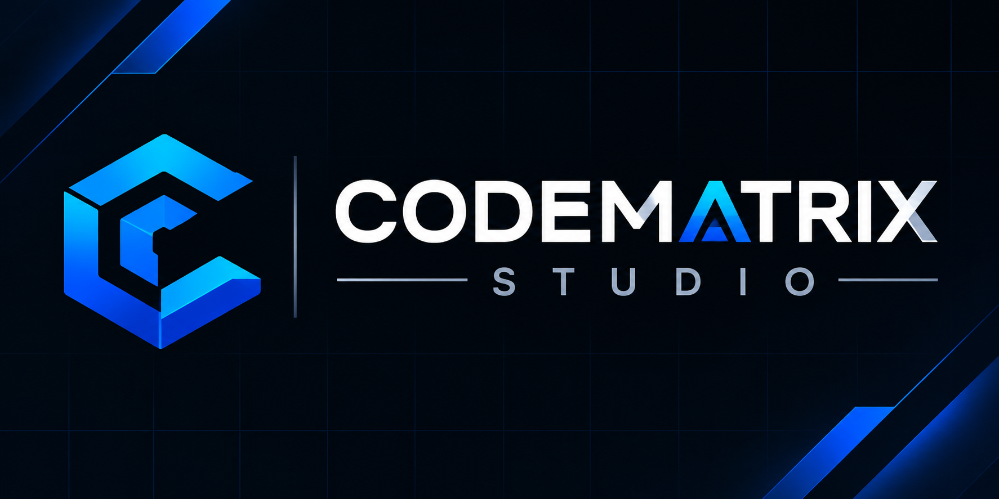

  

# CodeMatrix STUDIO

Независимый разработчик PHP и 1С-Битрикс. Работаю самостоятельно, напрямую с заказчиками и как внешний разработчик для команд и веб-студий.

Специализируюсь на backend-разработке и решении технических задач для проектов на 1С-Битрикс: от отдельных доработок и интеграций до модернизации и сопровождения существующих сайтов.

## Направления работы

- Разработка и доработка компонентов и модулей 1С-Битрикс
- PHP backend и разработка API
- Интеграции с 1С и внешними сервисами
- Обмен и синхронизация данных
- Исправление ошибок, оптимизация и повышение производительности
- Миграции, обновление и модернизация проектов
- Техническая поддержка и сопровождение
- Разработка под White Label и сотрудничество с веб-студиями

## Опыт

17+ лет коммерческой разработки на PHP и 1С-Битрикс.

Работаю самостоятельно, подключаясь к проектам напрямую или в качестве внешнего разработчика для команд и веб-студий.

## Проекты

- [Bitrix Quick Start](https://github.com/codematrix-studio/bitrix-quickstart)
- [CodeMatrix Popup](https://github.com/codematrix-studio/codematrix.popup)
- [CodeMatrix Elemmass](https://github.com/codematrix-studio/codematrix.elemmass)

## Контакты

- Электронная почта: [codematrix.studio@gmail.com](mailto:codematrix.studio@gmail.com)
- Сайт: https://codematrix-studio.github.io/
- GitHub: https://github.com/codematrix-studio
